 

     

 

<table>
<tr>
<td width="50%" valign="top">

### 💼 Experience

**Indie Developer** — macOS & Apple Ecosystem · `2026.06 – now`

**ESD Services Limited (Hong Kong)** — Mobile & Full-Stack Developer · `2024.12 – 2026.06` 
Delivered banking & retail iOS apps (UIKit / Swift / OC interop), a pnpm/Turborepo e-commerce backend + Clean-Architecture push microservice (49× spike recovery), a React/dnd-kit drag-and-drop CMS form builder, and Next.js enterprise platforms.

**Early iOS Roles, Shenzhen** · `2023.07 – 2024.10` 
Health app client UI, wearable-device iOS SDK delivery, and a social video feed app.

</td>
<td width="50%" valign="top">

### 🚀 Shipped Native Apps

- [**Linger**](https://linger.levicraft.app/) — floating desktop lyrics with Metal aurora & XDR HDR (v1.0.2 · Swift 6 + Metal · notarized download)
- [**Voltyn**](https://voltyn.pages.dev/en/) — Apple Silicon power & battery monitor (Mac App Store · WidgetKit + IOKit)
- [**Glasswitch**](https://glasswitch.pages.dev/) — default browser switcher (Mac App Store · Liquid Glass + Sandbox)
- [**MindNotes**](https://apps.apple.com/app/id6819075811) — floating Markdown quick-capture (Mac App Store)
- [**CodexSessionViewer**](https://github.com/LeiZiKang/CodexSessionViewer) — native GUI for Codex / Claude Code logs (Mac App Store)
- [**UTCTimeLooker**](https://github.com/LeiZiKang/UTCTimeLooker) — instant UTC timestamp converter (Mac App Store)
- [**KangCharge**](https://github.com/LeiZiKang/KangCharge) — cross-platform macOS / iOS / watchOS charger controller over MCP

</td>
</tr>
</table>

### ✍️ Engineering write-ups

Production problems from commercial work, and how I fixed them.

**Backend & infrastructure**
- [A 49× traffic spike, 16.6% DB CPU, and an exhausted connection pool](https://levi-blog.pages.dev/blog/49x-traffic-spike-connection-pool-en/) — why an uncached maintenance check saturated Prisma's pool and the same-day cache + 503 fix
- [Moving push notifications to FCM topics](https://levi-blog.pages.dev/blog/fcm-topic-push-en/) — Node.js push for a membership app; keeping subscriptions consistent across providers
- [When a service can't reach Redis](https://levi-blog.pages.dev/blog/azure-redis-nat-en/) — Azure VNet integration quietly changed the outbound IP
- [Load-testing an API with JMeter](https://levi-blog.pages.dev/blog/jmeter-load-test-en/) — one plan, three profiles, and tracing errors back to root causes

**iOS**
- [Three levels of modularizing an old UIKit project](https://levi-blog.pages.dev/blog/uikit-modularization-en/) — components, view models, packages · [demo repo](https://github.com/LeiZiKang/uikit-modularization-demo)
- [CocoaPods → SPM, and then back again](https://levi-blog.pages.dev/blog/cocoapods-spm-rollback-en/) — planning a migration vs. planning how to land it
- [An API mock kit on URLProtocol](https://levi-blog.pages.dev/blog/api-mock-kit-en/) — shipping screens before the backend exists
- [A global double-tap guard with method swizzling](https://levi-blog.pages.dev/blog/swizzling-duplicate-taps/) — Objective-C runtime safety and edge-case trade-offs

[All posts on the blog →](https://levi-blog.pages.dev/)

### 🛠️ Open-source developer tools

- [**agent-memory**](https://github.com/LeiZiKang/agent-memory) — plain-file project memory + bloat linter shared by Claude Code and Codex
- [**codex-delegate**](https://github.com/LeiZiKang/codex-delegate) — brief / build / review delegation workflow between Claude Code and local Codex CLI
- [**clawd-usage-weather**](https://github.com/LeiZiKang/clawd-usage-weather) — TypeScript status-line extension with local usage forecasting

### 🧰 Stack

