 

   

 

<table>
<tr>
<td width="50%" valign="top">

### 💼 Work

**Indie** — macOS apps · `2026.06 – now`

**ESD Services (Hong Kong)** — Mobile Developer · `2024.12 – 2026.06` 
iOS + full-stack delivery for HK clients: banking and retail apps, an e-commerce backend and push service, event and hospitality platforms.

**Early iOS roles, Shenzhen** · `2023.07 – 2024.09` 
A health app, a wearable SDK and a social video app.

</td>
<td width="50%" valign="top">

### 🚀 Shipped on the Mac App Store

- [**MindNotes**](https://apps.apple.com/app/id6819075811) — quick capture notes
- [**Voltyn**](https://leizikang.github.io/voltyn-site/) — power & battery monitor
- [**Glasswitch**](https://apps.apple.com/app/id6809678536) — default browser switcher (extends an open-source project)
- [**CodexSessionViewer**](https://github.com/LeiZiKang/CodexSessionViewer) — GUI for Codex / Claude Code sessions
- [**UTCTimeLooker**](https://github.com/LeiZiKang/UTCTimeLooker) — UTC timestamps, one click

</td>
</tr>
</table>

### 🤖 Agent tooling I use every day

| Repo | What it does |
|---|---|
| [**job-agent-kit**](https://github.com/LeiZiKang/job-agent-kit) | Clone, open Claude Code, say "set me up" — an agent-driven job search |
| [**agent-memory**](https://github.com/LeiZiKang/agent-memory) | Plain-file project memory shared by Claude Code and Codex |
| [**codex-delegate**](https://github.com/LeiZiKang/codex-delegate) | Claude directs, Codex executes, Claude reviews |
| [**clawd-usage-weather**](https://github.com/LeiZiKang/clawd-usage-weather) | A hopping Clawd and a usage forecast above your prompt |

### 🧰 Stack

